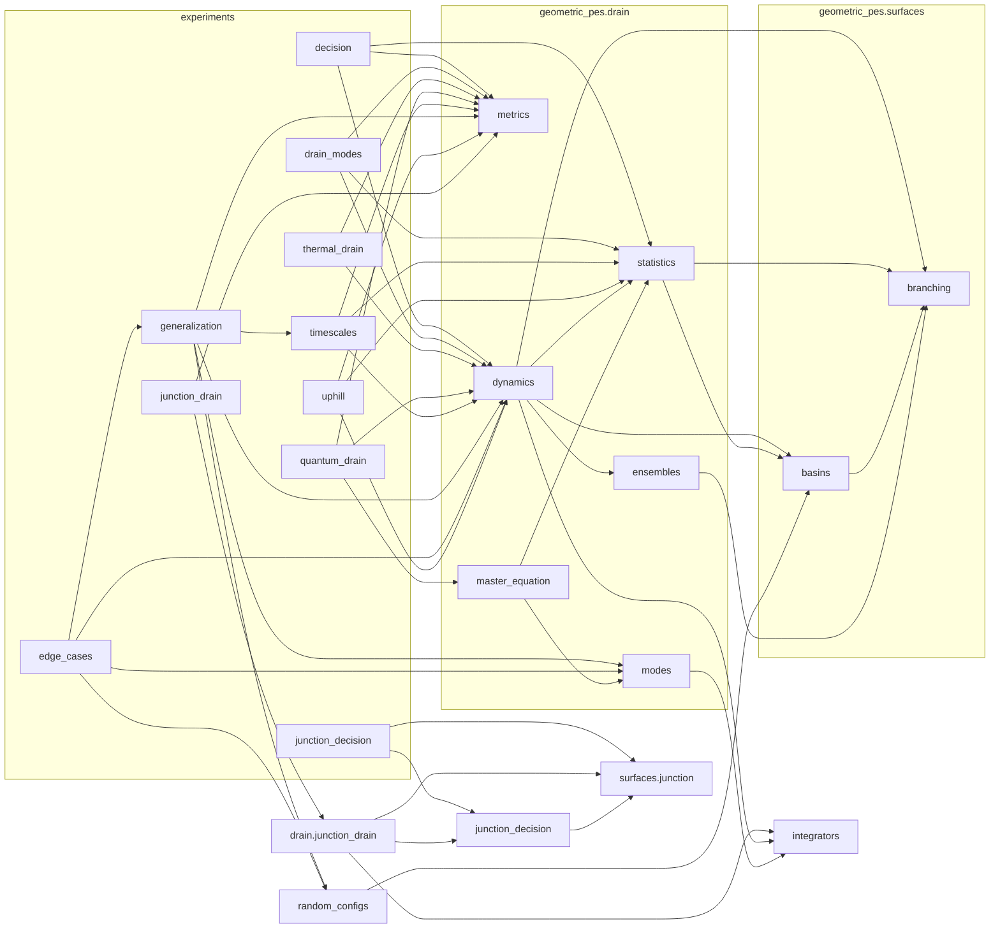

# How the code is organized

The library (`geometric_pes/`) holds the models, integrators and measurements. The experiments
(`experiments/`) are thin drivers that read their parameters from `config/experiments.toml`,
call the library, cache raw runs under `results/`, and write one JSON summary each. Nothing in
the library plots.

```
geometric_pes/
├── config.py            parameters and surface variants, from config/experiments.toml
├── integrators.py       velocity Verlet / BAOAB / Brownian steps; ohmic Caldeira–Leggett modes
├── io.py                save .npz / .json with their parameters and git version
├── random_configs.py    random surfaces, spectra, couplings for the out-of-sample test
├── junction_decision.py junction cases, transverse / thermal / coherent initial states, thermal sums
├── surfaces/
│   ├── branching.py     the branching surface V(x, y): VRI, product wells, valley bend
│   ├── basins.py        Setup: stationary points, labels, basin map, commitment levels
│   └── junction.py      two-state ET junction: surfaces, grid, quantum and classical engines
├── drain/
│   ├── ensembles.py     flux ensemble on TS1, reactant-basin ensemble, basin cores
│   ├── modes.py         spectral densities, coupling patterns, friction on the exchange mode
│   ├── statistics.py    2D and many-mode references (classical, quantum), TST rates
│   ├── dynamics.py      run_rest, run_thermal, run_qct_bose, run_rstart
│   ├── metrics.py       φ₁, memory m and r, inversion ι, back-transfer B, timescales, levels
│   ├── junction_drain.py   the junction coupled to N drain modes (surface hopping at the CI)
│   └── master_equation.py  Bloch–Redfield exchange time of relaxed products
└── two_state/           the original two-state, two-coordinate funnel model
experiments/             one driver per study (all accept --quick)
config/experiments.toml  every parameter
tests/                   invariants of the integrators, models and drain toolkit
```

## Which experiment calls which utility

The diagram is not exhaustive. It shows the calls that define each experiment; every driver also
uses `config` (parameters, surfaces) and `io` (caching, summaries) through `experiments/_common.py`.



## The experiments

| Driver | Question | Main calls | Config section |
|---|---|---|---|
| `decision.py` | Does the geometry make the product decision? (A and B have identical stationary points.) | `dynamics.run_rest` (drain off), `metrics.metrics`, `statistics.stat_fractions` | `[decision]` |
| `drain_modes.py` | Do the molecule's own modes keep the decision? | `dynamics.run_thermal` at θ = 0, `metrics.summarize` | `[drain_modes]` |
| `thermal_drain.py` | Which rung does thermal mixing remove first? | `dynamics.run_thermal`, `metrics.summarize` | `[thermal_drain]` |
| `quantum_drain.py` | Do quantum modes keep it, and how fast do relaxed products exchange? | `dynamics.run_qct_bose`, `metrics.summarize` (both references), `master_equation.redfield_case` | `[quantum_drain]` |
| `timescales.py` | How do decision, drain and exchange times compare? | `dynamics.run_rest`, `metrics.metrics`, `metrics.exchange_time`, `statistics.p_return` | `[timescales]` |
| `generalization.py` | Does the competition predict the outcome on surfaces, spectra and couplings it was not fitted to? | `random_configs.test_configs` / `valid`, `modes.modes`, `modes.gamma_exchange`, `dynamics.run_rest`, `metrics.metrics`; the training grid is `timescales` | `[generalization]` |
| `edge_cases.py` | What happened in the cases the *a priori* criterion gets wrong? | `dynamics.run_rest(record=True)`, `modes.modes`; reads the `generalization` summary | `[edge_cases]` |
| `uphill.py` | Is an endothermic transfer held once crossed, or initiated from R? | `dynamics.run_thermal`, `run_qct_bose`, `run_rstart`, `metrics.transfer_metrics`, `statistics.reference_shares` | `[uphill]` |
| `junction_decision.py` | After an electron-transfer crossing, can the decision be quantum? (`--part` distance, transverse, thermal, coherent) | `surfaces.junction.quantum` / `classical`, `junction_decision.params`, `pset`, `thermal_init`, `packet_xy`, `thermal` | `[junction]` |
| `junction_drain.py` | Is a decision made after the crossing kept by the same drain? | `drain.junction_drain.run`, `metrics.summarize` | `[junction_drain]` |

Run order matters only where one driver reads another's output: `generalization` reuses the
`timescales` runs as its training grid, and `edge_cases` reads the `generalization` summary.

## What each drain runner measures

All runners start the flux ensemble on the TS1 line (except `run_rstart`, which starts inside R),
couple the reacting coordinates to N harmonic modes with a counterterm, integrate the closed
system with velocity Verlet, and return per-trajectory records.

| Runner | Modes start | Used for |
|---|---|---|
| `run_rest` | at rest; any spectrum (`modes=(w, c, which)`) and any surface (`surface=`) | timescales, generalization, edge cases (`record=True` keeps every switch and an energy series) |
| `run_thermal` | classical Boltzmann at θ = k_BT_m/ΔE‡_PP | drain modes (θ = 0), thermal drain, uphill |
| `run_qct_bose` | Bose-occupied above the zero point, no zero-point energy | quantum drain, uphill |
| `run_rstart` | at rest, ensemble inside R | uphill (initiation) |

## Parameters

Every number an experiment uses is in `config/experiments.toml`: the surface variants (as
overrides of the `Surface` defaults), shared run settings, each experiment's grid, and the ranges
of the random draws. Point `GEOMETRIC_PES_CONFIG` at another file to run with different values.
Library functions keep their own defaults so they can be used without the config.
